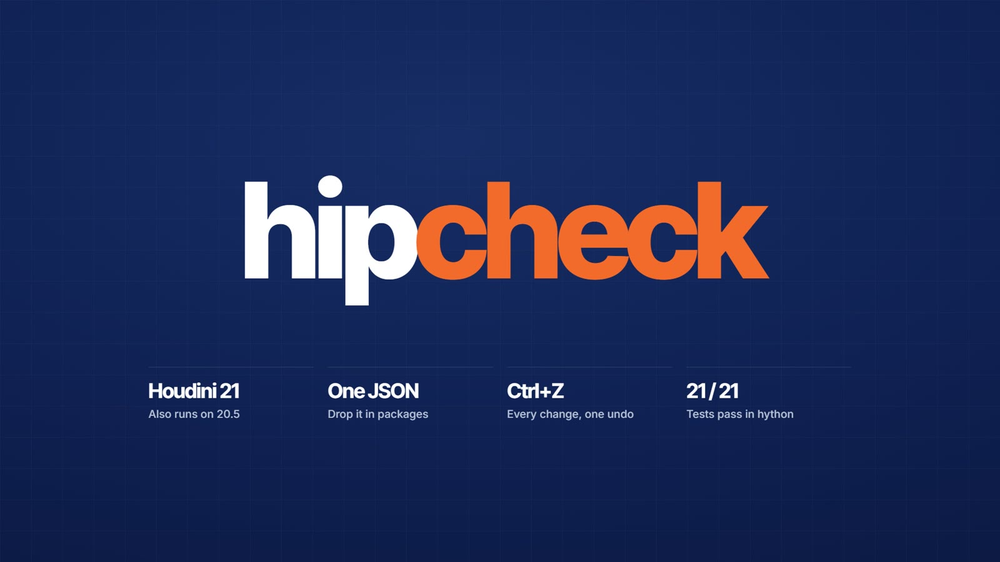

<p align="center"><a href="https://kurtliu309.github.io/hipcheck/"></a></p>

<p align="center">
  <b>Broken paths and dead nodes. Found in one click.</b><br>
  <a href="https://kurtliu309.github.io/hipcheck/">Project page &amp; live demo</a> ·
  <a href="https://github.com/kurtliu309/hipcheck/releases/latest">Download</a> ·
  <a href="docs/assets/hipcheck-en.mp4">Watch the film (50 s)</a>
</p>

<p align="center"></p>

# hipcheck

A small Houdini tool that checks a scene for path problems and cleans up nodes
that do nothing.

- **Check** (whole hip): input files that do not exist, and hardcoded absolute
  paths that will break when the project moves.
- **Clean** (current SOP network): floating nodes and unused branches — nodes
  whose result never reaches anything that matters. Select them, colour them,
  ignore them, or delete them.

Everything hipcheck changes is one undo step: **Ctrl+Z** reverts it.

Requires Houdini 21 (written to also run on 20.5).

## Install

1. Put the whole `hipcheck` folder anywhere you like.
2. Copy `hipcheck.json` into your Houdini user preferences `packages` folder
   (create `packages` if it does not exist):
   - Windows: `Documents/houdini21.0/packages`
     (with OneDrive: `OneDrive/Documents/houdini21.0/packages`)
   - Linux: `~/houdini21.0/packages`
   - macOS: `~/Library/Preferences/houdini/21.0/packages`
3. Open the copied `hipcheck.json` and change the one path to where you put the
   folder, using forward slashes:
   ```json
   {"HIPCHECK": "D:/tools/hipcheck"}
   ```
4. Restart Houdini.

## Open

1. On a shelf bar click `+` -> **Shelves** -> tick **hipcheck** (it is near the
   bottom of the list). A `hipcheck` shelf tab appears; you only do this once.
2. Click the **hipcheck** button on that tab.

Optional hotkey: right-click the button -> **Edit Tool...** -> **Hotkeys**.

You can also open it from the Python Shell:

```python
import hipcheck.ui; hipcheck.ui.show()
```

## The window

```
[Check (3)] [Clean (7)]                                  [Rescan]
+--------------------------------------------------------------+
|  list                                                        |
|  [Select All]                              [Delete Selected] |
+--------------------------------------------------------------+
[Color Selected]                 [ ] Show Ignored [Ignore Selected]
```

- **Rescan** scans again (the window does not update by itself).
- Click a row to select its node in Houdini, if the node is in the network you
  are looking at. Nothing happens for nodes in other networks. Press `F` in the
  network editor to frame the selection.
- Ctrl / Shift click to select several rows. **Select All** selects every row.
- The **jump** icon at the right end of a row (or a double-click on the row)
  goes to the node: it switches the network editor to the node's network, then
  selects and frames it.
- **Ctrl+C** or right-click -> **Copy Path** copies the node paths of the
  selected rows.
- Click a column header to sort by it.

### Check tab

| Type | Meaning |
|---|---|
| Missing input file | A file path the node reads from does not exist on disk. |
| Absolute path | The path is typed as `D:/...` or `//server/...` instead of starting with `$HIP` / `$JOB`. |

Not reported, on purpose:
- parameters still at their default value (fresh cameras, materials, ROPs);
- output paths of nodes that write files (ROPs, File Cache in write mode, ...),
  which do not exist until you render or cache;
- relative paths such as `defcam.bgeo`, which Houdini finds in its own folders;
- nodes inside locked HDAs, and hidden or greyed-out parameters.

A path that uses `$F` counts as found if the file exists at the current frame,
the first frame or the last frame.

### Clean tab

Works on the SOP network the network editor is showing when you scan.

A node is **kept** if it is, or feeds into, any of:
- a node with the display, render, template or footprint flag;
- a node whose name starts with `OUT` (any case);
- a node that writes files (File Cache, ROPs);
- a locked node, or a node with a comment;
- a node referenced from anywhere in the hip (`ch()` expressions, Object Merge
  paths, `op:` paths, node names in parameters or wrangle code).

Everything else is listed:
- **Floating**: a chain not connected to anything that is kept.
- **Unused branch**: a chain that takes input from the kept part but whose
  output goes nowhere.

Rows are grouped Status -> Chain -> node. Selecting a Status row selects all of
its nodes; selecting a Chain row selects that chain.

**Delete Selected** first scans again and only deletes nodes that are still
unused, then asks for confirmation. Ctrl+Z brings them back.

### Colour and ignore

- **Color Selected** turns the selected nodes red, so you can look at them in
  the network before deciding.
- **Ignore Selected** marks the selected nodes so they no longer show up in
  either tab. The mark is saved with the hip file.
- Tick **Show Ignored** to list ignored nodes again (greyed out). Select them
  and the button reads **Unignore Selected**.

## Limitations

- Cleaning works in SOP networks only (checking covers the whole hip).
- Scanning runs in the foreground; very large scenes may pause for a moment.

## Tests

Run headless with hython from the hipcheck folder:

```
hython tests/run_tests.py
```

The last line reads `ALL PASS n/n` or `FAIL k/n`.

## License

MIT. See [LICENSE](LICENSE).
